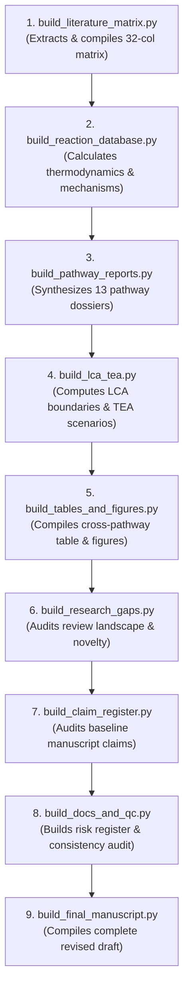

# API & Script Reference: Programmatic Data Engine

> **Document:** `API.md`  
> **Platform:** Evidence-Based CCU Research & Data Engine  
> **Status:** Canonical Production Reference  
> **Last Updated:** October 2026  

---

## Table of Contents

- [Overview & Interface Philosophy](#overview--interface-philosophy)
- [Script Execution Sequence & Pipeline Orchestration](#script-execution-sequence--pipeline-orchestration)
- [Standard CLI Flags & Exit Codes](#standard-cli-flags--exit-codes)
- [Comprehensive Script Specifications](#comprehensive-script-specifications)
  - [`build_literature_matrix.py`](#31-build_literature_matrixpy)
  - [`build_reaction_database.py`](#32-build_reaction_databasepy)
  - [`build_pathway_reports.py`](#33-build_pathway_reportspy)
  - [`build_lca_tea.py`](#34-build_lca_teapy)
  - [`build_tables_and_figures.py`](#35-build_tables_and_figurespy)
  - [`build_claim_register.py`](#36-build_claim_registerpy)
  - [`build_research_gaps.py`](#37-build_research_gapspy)
  - [`build_docs_and_qc.py`](#38-build_docs_and_qcpy)
  - [`build_final_manuscript.py`](#39-build_final_manuscriptpy)
- [Programmatic Query Recipes](#programmatic-query-recipes)
  - [Python / Pandas](#python--pandas-recipe)
  - [R](#r-recipe)
  - [Command-Line (csvkit / awk)](#command-line-csvkit--awk-recipe)
- [Architectural Scope & Data Guarantees](#architectural-scope--data-guarantees)

---

## 1. Overview & Interface Philosophy

This repository does **not** expose a public HTTP web API or REST microservice. In accordance with its scientific data engineering design, the **API of this platform** consists of:

1. **The CLI Script Execution Interface (`scripts/*.py`):** Deterministic, reproducible Python build modules that process raw bibliometric data, compute thermodynamic state functions, normalize metrics, and output structured datasets.
2. **The Structured Data Schema Interface (`research/**/*.csv`):** Standardized RFC 4180 CSV databases that serve as the authoritative programmatic data contract for researchers, data scientists, and publication templates.
3. **Programmatic Query Recipes:** Standard interfaces for consuming and querying repository datasets via Python (Pandas/Polars), R, or POSIX CLI tools.

---

## 2. Script Execution Sequence & Pipeline Orchestration

All scripts are idempotent and can be executed independently or in sequence. The recommended orchestration pipeline is:



---

## 3. Standard CLI Flags & Exit Codes

All build scripts in `scripts/` accept standard CLI arguments and return standard POSIX exit codes:

| Flag | Type | Description |
|---|---|---|
| `-h`, `--help` | Flag | Display script usage, arguments, and exit. |
| `--output <path>` | Path | Override the default output destination file. |
| `--output-dir <path>`| Path | Override the default output destination directory. |
| `--verify` | Flag | Validate schema integrity, column counts, and DOI links without writing to disk. |
| `-v`, `--verbose` | Flag | Enable detailed debugging logs during script execution. |

### Exit Codes
- **`0`**: Successful execution; target datasets or reports generated and validated.
- **`1`**: Runtime error, file I/O exception, or unhandled assertion failure.
- **`2`**: Command-line syntax error (unrecognized flag or invalid argument).

---

## 4. Comprehensive Script Specifications

### 4.1 `build_literature_matrix.py`
*Extracts, verifies, and compiles the 32-column Master Literature Matrix.*

- **Path:** `scripts/build_literature_matrix.py`
- **CLI Options:** `--output <path>`, `--verify`, `--verbose`
- **Output Target:** `research/literature/MASTER_LITERATURE_MATRIX.csv`
- **Primary Schema:** 32 Columns (`Paper_ID`, `Citation_Key`, `Author_Year`, `Journal`, `Publication_Year`, `DOI`, `Pathway_Class`, `Reactants`, `Target_Product`, `Catalyst_Composition`, `Reactor_Architecture`, `Reaction_T_C`, `Reaction_P_bar`, `Electrolyte_Composition`, `Current_Density_mA_cm2`, `Cell_Voltage_V`, `Overpotential_V`, `Faradaic_Efficiency_Percent`, `Single_Pass_Conversion_Percent`, `Selectivity_Percent`, `Space_Time_Yield`, `Yield_Units`, `Energy_Efficiency_Percent`, `Catalyst_Stability_Hours`, `Degradation_Mechanism`, `Hydrogen_Source`, `Upstream_Energy_Input`, `Product_Permanence_Class`, `Product_Half_Life`, `Current_TRL`, `Verification_Status`, `Audit_Notes`).

---

### 4.2 `build_reaction_database.py`
*Calculates thermodynamic state functions and balances 28 chemical reaction networks.*

- **Path:** `scripts/build_reaction_database.py`
- **CLI Options:** `--output <path>`, `--thermo-check`, `--verbose`
- **Output Targets:**
  - `research/chemistry/REACTION_DATABASE_FINAL.csv`
  - `research/chemistry/REACTION_DATABASE.csv`
- **Primary Schema:** 25 Columns (`Reaction_ID`, `Reaction_Family`, `Reaction_Name`, `Balanced_Equation`, `Reactants`, `Products`, `Stoichiometric_CO2_mol`, `Delta_H0_kJ_per_mol`, `Delta_G0_kJ_per_mol`, `E0_V_vs_RHE`, `Thermodynamic_Spontaneity`, `Exo_or_Endothermic`, `Optimum_Temperature_C`, `Optimum_Pressure_bar`, `Representative_Catalyst`, `Primary_Source_DOI`, `Verification_Status`).

---

### 4.3 `build_pathway_reports.py`
*Synthesizes dedicated technical dossiers for each of the 13 carbon transformation routes.*

- **Path:** `scripts/build_pathway_reports.py`
- **CLI Options:** `--pathway <name>`, `--all`, `--output-dir <path>`
- **Output Targets:** `research/pathways/*.md` (13 technical dossiers).

---

### 4.4 `build_lca_tea.py`
*Computes life-cycle assessment boundaries and techno-economic sensitivity scenarios.*

- **Path:** `scripts/build_lca_tea.py`
- **CLI Options:** `--output <path>`, `--grid-scenario <val>`
- **Output Targets:**
  - `research/lca_tea/LCA_REVIEW.md`
  - `research/lca_tea/TEA_REVIEW.md`
  - `research/lca_tea/SCENARIO_COMPARISON.csv`

---

### 4.5 `build_tables_and_figures.py`
*Compiles unified cross-pathway matrices and blueprints for publication vector figures.*

- **Path:** `scripts/build_tables_and_figures.py`
- **CLI Options:** `--output-dir <path>`, `--verbose`
- **Output Targets:**
  - `research/tables/TABLE_AUDIT.md`
  - `research/tables/CROSS_PATHWAY_TABLE.csv`
  - `research/tables/FINAL_CROSS_PATHWAY_COMPARISON.csv`
  - `research/figures/FIGURE_AUDIT.md`
  - `research/figures/FIGURE_PLANS.md`

---

### 4.6 `build_claim_register.py`
*Audits baseline empirical claims against primary literature standards.*

- **Path:** `scripts/build_claim_register.py`
- **CLI Options:** `--output <path>`, `--filter <status>`
- **Output Target:** `research/evidence/CLAIM_REGISTER.csv` (12 columns, 16 audited baseline claims).

---

### 4.7 `build_research_gaps.py`
*Audits competing review literature and documents 10 major industrial bottlenecks.*

- **Path:** `scripts/build_research_gaps.py`
- **CLI Options:** `--output-dir <path>`, `--verbose`
- **Output Targets:**
  - `research/gaps/REVIEW_LANDSCAPE_2020_2025.md`
  - `research/gaps/RESEARCH_GAPS.md`
  - `research/gaps/REVIEW_NOVELTY_ANALYSIS.md`

---

### 4.8 `build_docs_and_qc.py`
*Generates the peer-review risk register, scientific consistency audit, and revision blueprint.*

- **Path:** `scripts/build_docs_and_qc.py`
- **CLI Options:** `--output-dir <path>`, `--audit-only`
- **Output Targets:**
  - `research/audit/PUBLICATION_RISK_REGISTER.md`
  - `research/evidence/EVIDENCE_COVERAGE_REPORT.md`
  - `research/audit/FINAL_SCIENTIFIC_CONSISTENCY_AUDIT.md`
  - `manuscript/revisions/REVISION_PLAN.md`
  - `docs/DECISION_LOG.md`
  - `docs/RESEARCH_WORKFLOW.md`

---

### 4.9 `build_final_manuscript.py`
*Compiles the comprehensive, publication-ready revised review manuscript.*

- **Path:** `scripts/build_final_manuscript.py`
- **CLI Options:** `--output <path>`, `--verbose`
- **Output Target:** `manuscript/revisions/MANUSCRIPT_FINAL_RESEARCH_DRAFT.md` (488 lines).

---

## 5. Programmatic Query Recipes

### Python / Pandas Recipe
```python
import pandas as pd

# Load the verified reaction database
df_rxn = pd.read_csv('research/chemistry/REACTION_DATABASE_FINAL.csv')

# Filter for electrochemical reactions producing C2+ chemicals
echem_c2 = df_rxn[
    (df_rxn['Reaction_Family'].str.contains('Electrochemical', case=False, na=False)) &
    (df_rxn['Products'].str.contains('C2H4|C2H5OH', case=False, na=False))
]
print(echem_c2[['Reaction_ID', 'Reaction_Name', 'Delta_G0_kJ_per_mol', 'Representative_Catalyst']])
```

### R Recipe
```r
library(readr)
library(dplyr)

# Load cross-pathway matrix
pathways <- read_csv("research/tables/FINAL_CROSS_PATHWAY_COMPARISON.csv")

# Filter mature pathways (TRL >= 7)
mature_pathways <- pathways %>%
  filter(Current_TRL >= 7) %>%
  select(Pathway_ID, Target_Product, Energy_Vector, Carbon_Permanence)

print(mature_pathways)
```

### Command-Line (csvkit / awk) Recipe
```bash
# Print all endothermic reactions (Delta_H0 > 0)
awk -F',' '$8 ~ /^[+][0-9]/ { print $1, $3, $8 " kJ/mol" }' research/chemistry/REACTION_DATABASE_FINAL.csv

# Count verified papers by pathway class
awk -F',' 'NR>1 {print $7}' research/literature/MASTER_LITERATURE_MATRIX.csv | sort | uniq -c | sort -nr
```

---

## 6. Architectural Scope & Data Guarantees

> **Architectural Notice:** The repository contains no HTTP network listeners, authentication middleware (JWT, OAuth), database connection pools, ORM layers (Prisma, SQLAlchemy), or external third-party microservices. All interactions occur locally through filesystem I/O and POSIX CLI standard streams.
