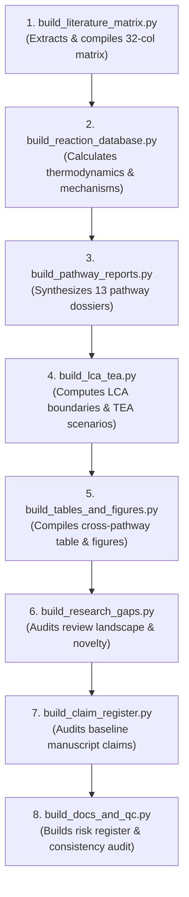

# API & Script Reference: Programmatic Data Engine

> **Document:** `API.md`  
> **Platform:** Evidence-Based CCU Research & Data Engine  
> **Status:** Canonical Production Reference  
> **Last Updated:** October 2026  

---

## 1. Overview & Interface Philosophy

This repository does **not** expose a public HTTP web API or REST endpoints. In accordance with its scientific data engineering design, the **API of this platform** consists of:

1. **The CLI Script Execution Interface (`scripts/*.py`):** Deterministic, reproducible Python build modules that process raw bibliometric data, compute thermodynamic state functions, normalize metrics, and output structured datasets.
2. **The Structured Data Schema Interface (`research/**/*.csv`):** Standardized RFC 4180 CSV databases that serve as the authoritative programmatic data contract for researchers, data scientists, and publication templates.
3. **Programmatic Query Recipes:** Standard interfaces for consuming and querying repository datasets via Python (Pandas/Polars), R, or POSIX CLI tools.

---

## 2. Script Execution Sequence & Pipeline Orchestration

All scripts are idempotent and can be executed independently or in sequence. The recommended orchestration pipeline is:



---

## 3. Comprehensive Script Specifications

### 3.1 `build_literature_matrix.py`
*Generates the 32-column Master Literature Matrix containing 22 landmark benchmarks from 2020–2025.*

- **Path:** `scripts/build_literature_matrix.py`
- **Execution:** `python3 scripts/build_literature_matrix.py`
- **Output Target:** `research/literature/MASTER_LITERATURE_MATRIX.csv`
- **Column Schema (32 Columns):**
  1. `Paper_ID` (string, unique key e.g., `METH-2020-TSOU`, `ECHEM-2024-XU`)
  2. `Year` (integer: 2012–2025)
  3. `Full_Title` (string)
  4. `Authors` (string)
  5. `Journal` (string)
  6. `DOI` (string, active primary DOI)
  7. `Publisher_URL` (string, URL)
  8. `Publication_Type` (e.g., `Primary Research`, `Review`, `Perspective`)
  9. `Research_Classification` (e.g., `Experimental/In-situ Spectroscopy`, `DFT/Modeling`)
  10. `CO2_Utilisation_Pathway` (e.g., `Thermocatalytic Hydrogenation`, `Electrochemical Reduction`)
  11. `Target_Product` (e.g., `Methanol`, `Ethylene`, `Pure Formic Acid`)
  12. `Chemical_Reaction` (string, balanced formula)
  13. `Catalyst_or_Biological_System` (string e.g., `In2O3/ZrO2`, `Bi nanosheets`)
  14. `Reaction_Mechanism` (detailed mechanistic summary)
  15. `Operating_Conditions` (temperature, pressure, feed ratios, GHSV)
  16. `CO2_Conversion` (percentage or single-pass metric)
  17. `Product_Yield` (normalized space-time yield e.g., `0.45 g/g_cat/h`)
  18. `Selectivity` (chemical selectivity percentage)
  19. `Faradaic_Efficiency` (percentage or `NR`/`N/A`)
  20. `Current_Density` (partial or total current density e.g., `100 mA/cm²`)
  21. `Energy_Consumption_or_Efficiency` (kWh/kg or thermal efficiency percentage)
  22. `Stability_or_Lifetime` (continuous operational hours e.g., `>1020 h`)
  23. `Product_Separation_Requirements` (downstream purification unit operations)
  24. `Carbon_Fate` (permanence timeframe e.g., `<6 months`, `>10,000 years`)
  25. `LCA_Findings` (net avoided GHG balance, grid sensitivity)
  26. `TEA_Findings` (CAPEX, OPEX, LCOP parity requirements)
  27. `Main_Limitations` (primary catalytic or engineering failure modes)
  28. `Relevance_to_Existing_Manuscript` (contextual upgrade notes)
  29. `Proposed_Manuscript_Section` (target section mapping)
  30. `Full_Text_Availability` (`Full-Text Available` or `Open Access`)
  31. `Verification_Status` (`VERIFIED`)
  32. `Extraction_Notes` (audit verification commentary)

---

### 3.2 `build_reaction_database.py`
*Generates the 25-column Thermodynamic and Mechanistic Reaction Database containing 22 balanced candidate reactions.*

- **Path:** `scripts/build_reaction_database.py`
- **Execution:** `python3 scripts/build_reaction_database.py`
- **Output Targets:**
  - `research/chemistry/REACTION_DATABASE.csv`
  - `research/chemistry/REACTION_MECHANISM_ANALYSIS.md`
  - `research/chemistry/NEW_REACTION_CANDIDATES.md`
- **Column Schema (25 Columns):**
  1. `Reaction_ID` (string, primary key e.g., `RXN-METH-01`, `RXN-ECHEM-05`)
  2. `Reaction_Family` (string e.g., `Methanol Hydrogenation`, `Electrochemical C-C Coupling`)
  3. `Reaction_Classification` (e.g., `Established industrial`, `Emerging catalyst/mechanism`)
  4. `Balanced_Chemical_Equation` (stoichiometrically balanced string with phases)
  5. `Physical_State` (e.g., `Gas-phase`, `Solid-liquid-gas interface`)
  6. `Thermodynamic_Enthalpy_dH0_kJ_mol` (float, kJ/mol at 298.15 K)
  7. `Thermodynamic_Gibbs_dG0_kJ_mol` (float, kJ/mol at 298.15 K)
  8. `Electrode_Potential_E0_V_vs_RHE` (string, standard potential vs RHE or `N/A`)
  9. `Catalyst_or_Electrode_System` (string)
  10. `Reaction_Mechanism` (text description of elementary steps)
  11. `Major_Intermediates` (comma-separated adsorbed species e.g., `*CO, *CHO, *OCH3`)
  12. `Operating_Conditions` (T, P, solvent, cell voltage)
  13. `Reported_Product` (primary target chemical)
  14. `Conversion` (percentage)
  15. `Yield` (space-time yield or production rate)
  16. `Selectivity` (percentage)
  17. `Faradaic_Efficiency` (percentage or `N/A`)
  18. `Energy_Requirements` (specific energy consumption)
  19. `Stability_Lifetime` (run time without deactivation)
  20. `Main_Side_Reactions` (parasitic pathways e.g., HER, RWGS, coking)
  21. `Product_Separation` (downstream train e.g., flash distillation, salt precipitation)
  22. `Carbon_Permanence` (duration before atmospheric re-emission)
  23. `LCA_TEA_Implications` (systems-level carbon and cost balance)
  24. `Original_Primary_Source_DOI` (string, active DOI)
  25. `Status_In_Existing_Manuscript` (audit evaluation e.g., `Omitted`, `Covered generically`)

---

### 3.3 `build_pathway_reports.py`
*Generates 13 comprehensive, multi-section research dossiers for every major CCU pathway.*

- **Path:** `scripts/build_pathway_reports.py`
- **Execution:** `python3 scripts/build_pathway_reports.py`
- **Output Targets (in `research/pathways/`):**
  - `Methanol.md`
  - `Urea_and_CN_Coupling.md`
  - `Electrochemical_Reduction.md`
  - `Photocatalytic_Conversion.md`
  - `Dry_and_Bi_Reforming.md`
  - `Polycarbonates_and_DMC.md`
  - `Carbon_Nanomaterials.md`
  - `Pharmaceutical_Applications.md`
  - `Biotechnology_and_MES.md`
  - `Mineralisation_and_Construction.md`
  - `Integrated_Capture_Conversion.md`
  - `Sustainability_LCA_TEA.md`
  - `Policy_and_Market_Analysis.md`

---

### 3.4 `build_lca_tea.py`
*Generates life-cycle assessment models, techno-economic reviews, and multi-scenario matrices.*

- **Path:** `scripts/build_lca_tea.py`
- **Execution:** `python3 scripts/build_lca_tea.py`
- **Output Targets:**
  - `research/lca_tea/LCA_REVIEW.md`
  - `research/lca_tea/TEA_REVIEW.md`
  - `research/lca_tea/SCENARIO_COMPARISON.csv`
- **CSV Schema (`SCENARIO_COMPARISON.csv`):**
  - `Pathway_Name`, `Product`, `Baseline_Fossil_Emissions_kgCO2e_kg`, `CCU_Net_Emissions_100pct_Renewable_kgCO2e_kg`, `CCU_Net_Emissions_Current_Grid_kgCO2e_kg`, `Grid_Break_Even_Threshold_gCO2e_kWh`, `Fossil_Parity_Price_USD_t`, `Current_CCU_LCOP_USD_t`, `Key_Cost_Driver`, `Break_Even_Requirements`

---

### 3.5 `build_tables_and_figures.py`
*Audits baseline tables/figures and generates production-ready cross-pathway tables and figure blueprints.*

- **Path:** `scripts/build_tables_and_figures.py`
- **Execution:** `python3 scripts/build_tables_and_figures.py`
- **Output Targets:**
  - `research/tables/TABLE_AUDIT.md`
  - `research/tables/CROSS_PATHWAY_TABLE.csv`
  - `research/figures/FIGURE_AUDIT.md`
  - `research/figures/FIGURE_PLANS.md`
- **CSV Schema (`CROSS_PATHWAY_TABLE.csv` - 14 Columns):**
  - `Pathway_ID`, `Pathway_Name`, `Target_Product`, `Primary_Reactants`, `Energy_Vector`, `Catalytic_or_Biological_System`, `Operating_Conditions`, `Key_Rate_Metric`, `Selectivity_or_FE`, `Single_Pass_Conversion_pct`, `Energy_Intensity`, `Carbon_Permanence`, `Current_TRL`, `Commercial_Facilities_or_Pilots`

---

### 3.6 `build_claim_register.py`
*Audits high-risk claims from the baseline manuscript and builds the claim verification register.*

- **Path:** `scripts/build_claim_register.py`
- **Execution:** `python3 scripts/build_claim_register.py`
- **Output Target:** `research/evidence/CLAIM_REGISTER.csv`
- **CSV Schema (`CLAIM_REGISTER.csv` - 12 Columns):**
  - `Claim_ID`, `Claim_Text`, `Manuscript_Section`, `Supporting_Source`, `Source_Type`, `DOI_or_URL`, `Exact_Evidence_Location`, `Quantitative_or_Qualitative`, `Verification_Status`, `Conflicting_Evidence`, `Risk_Level`, `Required_Action`

---

### 3.7 `build_research_gaps.py`
*Audits competing published reviews and synthesizes research gaps and novelty statements.*

- **Path:** `scripts/build_research_gaps.py`
- **Execution:** `python3 scripts/build_research_gaps.py`
- **Output Targets:**
  - `research/gaps/REVIEW_LANDSCAPE_2020_2025.md`
  - `research/gaps/RESEARCH_GAPS.md`
  - `research/gaps/REVIEW_NOVELTY_ANALYSIS.md`

---

### 3.8 `build_docs_and_qc.py`
*Generates the peer-review risk register, evidence coverage metrics, scientific consistency audit, and revision blueprint.*

- **Path:** `scripts/build_docs_and_qc.py`
- **Execution:** `python3 scripts/build_docs_and_qc.py`
- **Output Targets:**
  - `research/audit/PUBLICATION_RISK_REGISTER.md`
  - `research/evidence/EVIDENCE_COVERAGE_REPORT.md`
  - `research/audit/FINAL_SCIENTIFIC_CONSISTENCY_AUDIT.md`
  - `manuscript/revisions/REVISION_PLAN.md`
  - `docs/DECISION_LOG.md`
  - `docs/CHANGELOG.md`
  - `docs/RESEARCH_WORKFLOW.md`

---

## 4. Programmatic Query Recipes

Researchers can ingest, filter, and analyze the structured datasets using common data science tools.

### Python / Pandas Recipe
```python
import pandas as pd

# 1. Load the balanced reaction database
df_rxn = pd.read_csv('research/chemistry/REACTION_DATABASE.csv')

# Filter for electrochemical reactions producing C2+ chemicals
echem_c2 = df_rxn[
    (df_rxn['Reaction_Family'].str.contains('Electrochemical', case=False)) &
    (df_rxn['Reported_Product'].str.contains('Ethylene|Ethanol', case=False))
]
print(echem_c2[['Reaction_ID', 'Reported_Product', 'Faradaic_Efficiency', 'Energy_Requirements']])

# 2. Inspect high-risk claims flagged for complete purge
df_claims = pd.read_csv('research/evidence/CLAIM_REGISTER.csv')
fatal_claims = df_claims[df_claims['Risk_Level'] == 'CRITICAL']
for _, row in fatal_claims.iterrows():
    print(f"[{row['Claim_ID']}] Section: {row['Manuscript_Section']}\nAction: {row['Required_Action']}\n")
```

### R Recipe
```r
library(readr)
library(dplyr)

# Load cross-pathway matrix
pathways <- read_csv("research/tables/CROSS_PATHWAY_TABLE.csv")

# Filter mature pathways (TRL >= 7)
mature_pathways <- pathways %>%
  filter(Current_TRL >= 7) %>%
  select(Pathway_ID, Target_Product, Energy_Intensity, Carbon_Permanence)

print(mature_pathways)
```

### Command-Line (csvkit / awk) Recipe
```bash
# Print all reactions with positive Gibbs free energy (thermodynamically non-spontaneous)
awk -F',' '$7 ~ /^[+][0-9]/ { print $1, $4, $7 " kJ/mol" }' research/chemistry/REACTION_DATABASE.csv

# Count verified papers by target product
awk -F',' 'NR>1 {print $11}' research/literature/MASTER_LITERATURE_MATRIX.csv | sort | uniq -c | sort -nr
```

---

## 5. Architectural Verification & Scope Clarification

> **Architectural Notice:** The repository contains no HTTP network listeners, authentication middleware (JWT, OAuth), database connection pools, ORM layers (Prisma, SQLAlchemy), or external third-party microservices. All interactions occur locally through filesystem I/O and POSIX CLI standard streams.
