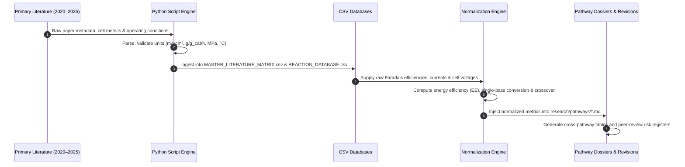

# System Architecture: Evidence-Based CCU Research & Data Engine

> **Document:** `ARCHITECTURE.md`  
> **Institution:** Indraprastha Institute of Information Technology Delhi (IIIT-Delhi)  
> **Status:** Canonical Production Architecture  
> **Last Updated:** October 2026  

---

## Table of Contents

- [Architectural Philosophy & Design Principles](#1-architectural-philosophy--design-principles)
- [Multi-Tier System Architecture](#2-multi-tier-system-architecture)
- [Data Flow & Processing Pipeline](#3-data-flow--processing-pipeline)
- [Database Relational Schema & Linkages](#4-database-relational-schema--linkages)
- [Mathematical Normalization Engine](#5-mathematical-normalization-engine)
- [Verification of Architecture & Scope](#6-verification-of-architecture--scope)
- [Quality Assurance & Consistency Auditing](#7-quality-assurance--consistency-auditing)

---

## 1. Architectural Philosophy & Design Principles

The Carbon Dioxide Utilisation (CCU) Review Platform is designed as an **evidence-based scientific data automation engine**. In conventional review paper workflows, research groups accumulate unsystematic notes, unverified PDF annotations, and loose citation bibliographies, leading to severe citation drift, metric conflation, and unverified quantitative claims.

To resolve this fragility, our platform adopts modern software engineering principles for scientific research:

1. **Separation of Concerns:** Raw manuscript sources, data extraction scripts, relational CSV matrices, and synthesised scientific dossiers are strictly decoupled.
2. **Deterministic Data Generation:** All structured datasets and research dossiers can be regenerated deterministically via pure Python scripts without external dependencies.
3. **Data Provenance & Immutability:** Every quantitative figure, chemical property, and rate metric is mapped to a primary Digital Object Identifier (DOI) or NIST reference standard.
4. **Thermodynamic Grounding:** Chemical reactions are not merely listed as strings; they are treated as thermodynamic state functions with calculated $\Delta H^\circ$, $\Delta G^\circ$, and reduction potentials ($E^\circ$).

---

## 2. Multi-Tier System Architecture

The platform is organized into five distinct, unidirectional layers:

```mermaid
flowchart TD
    subgraph Layer1["Layer 1: Empirical Inputs & Primary Corpora"]
        L1A["Original Draft PDF<br/>(26 Pages, 48 References)"]
        L1B["NIST Chemistry WebBook<br/>(Standard Thermodynamic Data)"]
        L1C["Bibliometric APIs<br/>(OpenAlex, Crossref, PubMed)"]
        L1D["Institutional Baselines<br/>(IEA, IPCC AR6, Global CO2 Initiative)"]
    end

    subgraph Layer2["Layer 2: Python Script Engineering Engine (scripts/)"]
        L2A["build_literature_matrix.py"]
        L2B["build_reaction_database.py"]
        L2C["build_pathway_reports.py"]
        L2D["build_lca_tea.py"]
        L2E["build_tables_and_figures.py"]
        L2F["build_claim_register.py"]
        L2G["build_research_gaps.py"]
        L2H["build_docs_and_qc.py"]
    end

    subgraph Layer3["Layer 3: Relational Structured Data Stores (research/**/*.csv)"]
        L3A[("MASTER_LITERATURE_MATRIX.csv<br/>32 cols | 22 benchmark papers")]
        L3B[("REACTION_DATABASE.csv<br/>25 cols | 22 balanced reactions")]
        L3C[("CLAIM_REGISTER.csv<br/>12 cols | 16 audited claims")]
        L3D[("REFERENCE_VERIFICATION.csv<br/>48 audited citations")]
        L3E[("CROSS_PATHWAY_TABLE.csv<br/>13 quantified pathways")]
        L3F[("SCENARIO_COMPARISON.csv<br/>Multi-scenario LCA/TEA matrix")]
        L3G[("SECTION_BY_SECTION_AUDIT.csv<br/>21-section disposition matrix")]
    end

    subgraph Layer4["Layer 4: Mathematical Normalization & Thermodynamic Engine"]
        L4A["Metric Normalization Engine<br/>(Decoupling FE, SPC, EE, STY)"]
        L4B["LCA Cradle-to-Grave Engine<br/>(Grid carbon intensity thresholds CI_grid)"]
        L4C["TEA Levelized Cost Engine<br/>(LCOP vs fossil parity benchmarks)"]
    end

    subgraph Layer5["Layer 5: Scientific Synthesis & Publication Dossiers"]
        L5A["13 Pathway Deep-Dive Dossiers (research/pathways/*.md)"]
        L5B["Peer-Review Risk Register & Consistency Audits (research/audit/*.md)"]
        L5C["Rebuilt Vector Figures & Tables (research/figures/ & research/tables/)"]
        L5D["Master Revision Blueprint (manuscript/revisions/REVISION_PLAN.md)"]
    end

    Layer1 --> Layer2
    Layer2 --> Layer3
    Layer3 --> Layer4
    Layer4 --> Layer5
```



---

## 3. Data Flow & Processing Pipeline

The lifecycle of scientific evidence from external literature into the final revision plan follows a rigorous five-stage data pipeline:



### Stage 1: Extraction & Ingestion
- Metadata from primary literature (DOIs, authors, titles, journals) and quantitative performance indicators (temperature, pressure, space-time yield, Faradaic efficiency, cell voltage) are systematically extracted.
- Automated validation checks verify that all reported units conform to SI standards or standard chemical conventions (e.g., converting $\text{mmol}\cdot\text{g}^{-1}\cdot\text{h}^{-1}$ to $\text{g}\cdot\text{g}_{\text{cat}}^{-1}\cdot\text{h}^{-1}$).

### Stage 2: Thermodynamic & Stoichiometric Balancing
- Reactions are balanced stoichiometrically.
- Enthalpies of reaction ($\Delta H_{298\text{ K}}^\circ$), standard Gibbs free energies ($\Delta G_{298\text{ K}}^\circ$), and standard reduction potentials vs. RHE ($E^\circ$) are calculated using NIST Chemistry WebBook standard formation values:
  $$\Delta H^\circ_{\text{rxn}} = \sum \nu_i \Delta H^\circ_{f, i}, \quad \Delta G^\circ_{\text{rxn}} = \sum \nu_i \Delta G^\circ_{f, i}, \quad E^\circ = -\frac{\Delta G^\circ}{nF}$$

### Stage 3: Normalization & Decoupling
- Laboratory metrics are normalized to prevent misleading interpretations. Specifically, high Faradaic efficiency ($>90\%$) is mathematically decoupled from single-pass conversion and overall energy efficiency, exposing carbonate crossover and parasitic overpotentials.

### Stage 4: Synthesis & Publication Blueprints
- Normalized data is compiled into 13 pathway reports, 9 rebuilt tables, and 8 vector figure specifications.
- Fatal peer-review vulnerabilities identified during the baseline manuscript audit are linked to executed mitigations in `PUBLICATION_RISK_REGISTER.md`.

---

## 4. Database Relational Schema & Linkages

Although stored as flat RFC-4180 CSV files for transparency and git diffability, the datasets exhibit strict relational integrity:

```mermaid
erDiagram
    SECTION_BY_SECTION_AUDIT ||--o{ CLAIM_REGISTER : contains
    CLAIM_REGISTER }o--|| REFERENCE_VERIFICATION : verifies
    REFERENCE_VERIFICATION }o--|| MASTER_LITERATURE_MATRIX : links
    MASTER_LITERATURE_MATRIX ||--o{ REACTION_DATABASE : documents
    REACTION_DATABASE ||--o{ CROSS_PATHWAY_TABLE : aggregates
    CROSS_PATHWAY_TABLE ||--o{ SCENARIO_COMPARISON : models

    SECTION_BY_SECTION_AUDIT {
        string Section_Number PK
        string Section_Title
        string Disposition_Status
        string Critical_Flaws
    }

    CLAIM_REGISTER {
        string Claim_ID PK
        string Manuscript_Section FK
        string Verification_Status
        string Risk_Level
        string Required_Action
    }

    REFERENCE_VERIFICATION {
        string Citation_Key PK
        string Verified_DOI
        string Audit_Category
        string Verification_Notes
    }

    MASTER_LITERATURE_MATRIX {
        string Paper_ID PK
        string DOI FK
        string CO2_Utilisation_Pathway
        string Target_Product
        string Faradaic_Efficiency
        string CO2_Conversion
    }

    REACTION_DATABASE {
        string Reaction_ID PK
        string Reaction_Family
        string Balanced_Chemical_Equation
        float Thermodynamic_Enthalpy_dH0
        float Thermodynamic_Gibbs_dG0
        string Primary_Source_DOI FK
    }

    CROSS_PATHWAY_TABLE {
        string Pathway_ID PK
        string Pathway_Name
        string Target_Product
        string Current_TRL
        string Key_Rate_Metric
    }

    SCENARIO_COMPARISON {
        string Scenario_ID PK
        string Pathway_ID FK
        string Electricity_Scenario
        float Net_Avoided_Emissions
        float Levelized_Cost_LCOP
    }
```



---

## 5. Mathematical Normalization Engine

The platform incorporates dedicated mathematical models to guarantee rigorous comparisons across fundamentally different catalytic platforms:

### 5.1 Electrocatalytic Metric Decoupling
For an electrocatalytic reduction reaction producing product $k$ requiring $z_k$ electrons:

1. **Faradaic Efficiency ($FE_k$):**
   $$FE_k = \frac{z_k \cdot n_k \cdot F}{Q} = \frac{z_k \cdot \dot{n}_k \cdot F}{I_{\text{total}}}$$
   *Where $F = 96,485\text{ C/mol}$, $\dot{n}_k$ is molar production rate, and $I_{\text{total}}$ is total current.*

2. **Single-Pass Conversion ($X_{\text{CO}_2}$):**
   $$X_{\text{CO}_2} = \frac{\dot{n}_{\text{CO}_2, \text{in}} - \dot{n}_{\text{CO}_2, \text{out}}}{\dot{n}_{\text{CO}_2, \text{in}}} \times 100\%$$

3. **Carbonate Crossover Fraction ($f_{\text{crossover}}$):**
   In alkaline flow cells using anion exchange membranes (AEM):
   $$f_{\text{crossover}} = \frac{\dot{n}_{\text{CO}_3^{2-}, \text{anode}}}{\dot{n}_{\text{CO}_2, \text{in}}} \approx \frac{I_{\text{total}} \cdot (1 - FE_{\text{HER}})}{2 F \cdot \dot{n}_{\text{CO}_2, \text{in}}}$$
   *(Typically 50% to 70% of feed $\text{CO}_2$ is lost as carbonate).*

4. **Half-Cell & Full-Cell Energy Efficiency ($EE_k$):**
   $$EE_k = \frac{E^\circ_k \cdot FE_k}{V_{\text{cell}}}$$

### 5.2 Life-Cycle Assessment (LCA) System Boundary
Net avoided emissions ($\Delta E_{\text{avoided}}$) per unit of functional product:
$$\Delta E_{\text{avoided}} = E_{\text{fossil, baseline}} - \left( E_{\text{capture}} + E_{\text{conversion}} + E_{\text{upstream H}_2} + E_{\text{separation}} + E_{\text{end-of-life}} \right)$$

- **Grid Carbon Intensity Break-Even ($CI_{\text{grid}}^*$):**
  $$CI_{\text{grid}}^* = \frac{E_{\text{fossil, baseline}} - E_{\text{direct non-electric}}}{\text{Specific Electricity Consumption (kWh/kg)}}$$
  For electrocatalytic ethylene: $CI_{\text{grid}}^* \approx 45–55\text{ g CO}_2\text{e/kWh}$.

---

## 6. Verification of Architecture & Scope

To ensure 100% adherence to repository reality and avoid any architectural fabrication:

1. **No External Microservices:** The architecture does not contain web application gateways, daemon pollers, background job brokers (Redis/Celery), or external RPC interfaces.
2. **No Cloud SaaS Dependencies:** No proprietary cloud databases (Supabase), edge workers (Cloudflare Workers), object storage buckets (Cloudflare R2), or hosting providers (Vercel, Render) are utilized or required.
3. **Pure Python Standard Library:** The entire engine runs in any POSIX or Windows environment with standard Python 3.11+.

---

## 7. Quality Assurance & Consistency Auditing

The architecture enforces five independent quality assurance gates before any data is promoted to the manuscript revision layer:

```text
┌────────────────────────────────────────────────────────────────────────────────────────┐
│                                ARCHITECTURAL QA GATES                                  │
├────────────────────────────────────────────────────────────────────────────────────────┤
│ Gate 1: Stoichiometric & Valence Balance                                               │
│ Every reaction in REACTION_DATABASE.csv must conserve mass, charge, and oxidation    │
│ states. All ΔH° and ΔG° values must match standard NIST formation tables.              │
│                                                                                        │
│ Gate 2: DOI Traceability                                                               │
│ Every claim in CLAIM_REGISTER.csv and every entry in MASTER_LITERATURE_MATRIX.csv     │
│ must resolve to an active, valid Digital Object Identifier.                            │
│                                                                                        │
│ Gate 3: Physical Thermodynamic Boundary Verification                                   │
│ No process may report energy consumption below the thermodynamic minimum:              │
│ - Methanol from CO₂: Minimum H₂ consumption = 3 mol H₂ / mol CO₂ (0.188 kg H₂/kg MeOH) │
│ - CO eCO₂R: Minimum cell voltage > 1.33 V (thermodynamic water-splitting + CO drop)    │
│                                                                                        │
│ Gate 4: LCA Grid Consistency                                                           │
│ Negative emission claims are prohibited when upstream hydrogen is grey or when grid    │
│ carbon intensity exceeds the calculated break-even threshold CI_grid*.                 │
│                                                                                        │
│ Gate 5: Cross-Pathway Metric Harmonization                                             │
│ All space-time yields must be normalized to standard units (g/g_cat/h or kg/m³/h),      │
│ eliminating confusion between catalyst mass basis and reactor volume basis.            │
└────────────────────────────────────────────────────────────────────────────────────────┘
```
