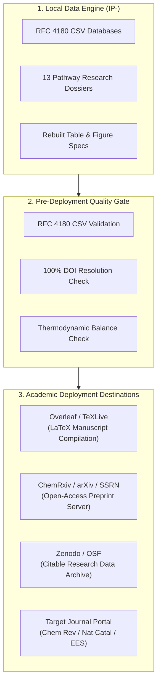

# Deployment & Publication Release Pipeline

> **Document:** `DEPLOYMENT.md`  
> **Platform:** Evidence-Based CCU Research & Data Engine  
> **Status:** Canonical Release Pipeline  
> **Last Updated:** October 2026  

---

## 1. Release Architecture & Scope Overview

In standard software engineering, deployment refers to continuous delivery of web applications to cloud servers. In this scientific research platform, **Deployment refers to the rigorous Academic Publication, Preprint Release, and Open-Access Data Archival Pipeline**.



---

## 2. Pre-Deployment Verification Gate

Before any manuscript or dataset release, execute the automated pre-release verification protocol:

```bash
# 1. Run all 8 data generation scripts
python3 scripts/build_literature_matrix.py
python3 scripts/build_reaction_database.py
python3 scripts/build_pathway_reports.py
python3 scripts/build_lca_tea.py
python3 scripts/build_tables_and_figures.py
python3 scripts/build_research_gaps.py
python3 scripts/build_claim_register.py
python3 scripts/build_docs_and_qc.py

# 2. Run data consistency gate
python3 -c "
import csv, glob
for path in glob.glob('research/**/*.csv', recursive=True):
    with open(path, 'r', encoding='utf-8') as f:
        reader = list(csv.reader(f))
        assert len(reader) > 1, f'Empty dataset: {path}'
print('==> Pre-deployment verification PASSED: All 6 core datasets intact.')
"
```

---

## 3. Overleaf & LaTeX Synchronization

The revised manuscript will be authored in LaTeX for final typesetting. The mapping between repository files and LaTeX compilation is structured as follows:

```text
LaTeX Project/
├── main.tex                          <-- Master driver file (frontmatter, structure)
├── sections/
│   ├── 01_abstract.tex               <-- Derived from manuscript/revisions/REVISION_PLAN.md
│   ├── 02_introduction.tex           <-- Derived from research/pathways/Policy_and_Market_Analysis.md
│   ├── 03_methodology.tex            <-- Derived from research/methodology/LITERATURE_REVIEW_PROTOCOL.md
│   ├── 04_thermodynamics.tex         <-- Derived from research/chemistry/REACTION_DATABASE.csv
│   ├── 05_thermocatalytic.tex        <-- Derived from research/pathways/Methanol.md & Dry_and_Bi_Reforming.md
│   ├── 06_electrocatalytic.tex       <-- Derived from research/pathways/Electrochemical_Reduction.md
│   ├── 07_photocatalytic.tex         <-- Derived from research/pathways/Photocatalytic_Conversion.md
│   ├── 08_polymers_dmc.tex           <-- Derived from research/pathways/Polycarbonates_and_DMC.md
│   ├── 09_nanomaterials.tex          <-- Derived from research/pathways/Carbon_Nanomaterials.md
│   ├── 10_biotechnology.tex          <-- Derived from research/pathways/Biotechnology_and_MES.md
│   ├── 11_mineralisation.tex         <-- Derived from research/pathways/Mineralisation_and_Construction.md
│   ├── 12_iccc.tex                   <-- Derived from research/pathways/Integrated_Capture_Conversion.md
│   ├── 13_lca_tea.tex                <-- Derived from research/lca_tea/LCA_REVIEW.md & TEA_REVIEW.md
│   └── 14_conclusions.tex            <-- Derived from manuscript/revisions/REVISION_PLAN.md
├── tables/                           <-- Auto-converted from research/tables/CROSS_PATHWAY_TABLE.csv
├── figures/                          <-- High-resolution vector PDFs from research/figures/FIGURE_PLANS.md
└── references.bib                    <-- Compiled from research/literature/MASTER_LITERATURE_MATRIX.csv
```

### Git-Overleaf Bridge
1. If using Overleaf Premium, link the Overleaf project directly to the GitHub remote (`https://github.com/L9G9N0/IP-.git`).
2. Alternatively, push compiled `.tex` files from a dedicated `manuscript/latex/` branch.

---

## 4. Open-Access Preprint Deployment (ChemRxiv / arXiv)

To establish priority of scientific discovery and gather peer feedback prior to formal peer review:

1. **Preprint Platform:** [ChemRxiv](https://chemrxiv.org/) (Primary chemistry preprint server) or [arXiv](https://arxiv.org/) (Chemical Physics / Systems Engineering).
2. **Author Alignment:** Confirm co-author approval from all contributors at IIIT-Delhi.
3. **Manuscript Bundle:** Generate single PDF compilation with integrated high-resolution vector figures.
4. **Supplementary Information (SI):** Export `research/literature/MASTER_LITERATURE_MATRIX.csv` and `research/chemistry/REACTION_DATABASE.csv` as Excel/CSV Supplementary Datasets.
5. **License Selection:** Select Creative Commons Attribution 4.0 International (CC BY 4.0).

---

## 5. Citable Research Data Archival (Zenodo / OSF)

To ensure permanent, tamper-proof long-term preservation of the data engine:

1. Connect the GitHub repository `https://github.com/L9G9N0/IP-` to **Zenodo** ([https://zenodo.org](https://zenodo.org)).
2. Create a formal GitHub Release tag (e.g., `v1.0.0-audit`).
3. Zenodo will automatically mint a permanent Digital Object Identifier (DOI) for the codebase, preserving the exact state of all chemical databases, scripts, and risk registers.
4. Include the Zenodo DOI badge in the primary `README.md`.

---

## 6. Target Journal Submission Pipeline

The manuscript is formatted for initial submission to premier peer-reviewed chemistry and energy journals:

| Journal | Publisher | Impact Factor | Focus Area | Fit Rationale |
|---|---|---|---|---|
| **Chemical Reviews** | ACS | 51.4 | Comprehensive, authoritative chemical overviews | Best suited for our exhaustive 13-pathway scope, reaction mechanisms, and metric normalization. |
| **Nature Catalysis** | Nature Portfolio | 42.8 | Transformative advances in catalytic science | Suited if manuscript is focused on catalyst durability, oxygen-vacancy dynamics, and eCO₂R scaling. |
| **Energy & Environmental Science** | RSC | 32.4 | Energy systems, techno-economics, and LCA | Suited for our grid carbon intensity thresholds and cross-pathway levelized cost models. |

---

## 7. Cloud SaaS Deployment Notice

> **Deployment Grounding Notice:** This repository does **NOT** require or utilize web hosting platforms (Vercel, Netlify, Render, AWS Amplify), serverless compute runtimes (AWS Lambda, Cloudflare Workers), or container orchestration (Kubernetes, Docker Compose). All assets are pure version-controlled research code, data, and scientific documentation.
