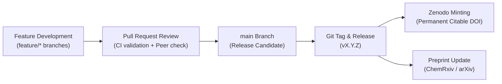

# Release Management & Versioning Strategy

> **Document:** `RELEASE.md`  
> **Platform:** Evidence-Based CCU Research & Data Engine  
> **Status:** Canonical Release Strategy  
> **Last Updated:** October 2026  

---

## Table of Contents

- [Versioning Specification (SemVer 2.0.0)](#1-versioning-specification-semver-200)
- [Release Cadence & Channels](#2-release-cadence--channels)
- [Release Checklist & Step-by-Step Procedure](#3-release-checklist--step-by-step-procedure)

---

## 1. Versioning Specification (SemVer 2.0.0)

This repository follows [Semantic Versioning 2.0.0](https://semver.org/):

$$\text{MAJOR}.\text{MINOR}.\text{PATCH}$$

- **MAJOR (vX.0.0):** Significant structural schema changes in relational CSV matrices, architectural redesigns of data generation pipelines, or breaking modifications to script CLI interfaces.
- **MINOR (v0.X.0 / v1.X.0):** Addition of new benchmark papers, newly verified chemical reaction pathways, new pathway dossiers, or non-breaking feature enhancements in build scripts.
- **PATCH (v1.0.X):** Correction of typographical errors, DOI link updates, chemical stoichiometric adjustments, or minor bug fixes in scripts.

---

## 2. Release Cadence & Channels



1. **Continuous Updates (`main` branch):** All tested and peer-reviewed pull requests are merged directly into `main`.
2. **Milestone Releases:** Tagged releases correspond to manuscript review milestones, journal revisions, or major annual literature updates.
3. **Zenodo Archiving:** Every official GitHub release triggers automated archiving to **Zenodo**, generating a permanent, citable academic DOI.

---

## 3. Release Checklist & Step-by-Step Procedure

Maintainers follow this protocol for all new releases:

1. **Verify Test Suite & RFC 4180 Compliance:**
   ```bash
   make test
   make lint
   make typecheck
   ```
2. **Regenerate Authoritative Artifacts:**
   ```bash
   make build
   ```
3. **Update Version Numbers & Changelog:**
   - Update `pyproject.toml` version string.
   - Update `CHANGELOG.md` with release notes and date under a new version heading.
4. **Commit & Create Tag:**
   ```bash
   git commit -am "chore(release): prepare v1.2.1"
   git tag -a v1.2.1 -m "Release v1.2.1: Updated benchmark metrics and schema fixes"
   git push origin main --tags
   ```
5. **Publish GitHub Release:**
   - Draft release notes on GitHub summarizing key scientific and codebase improvements.
   - Attach generated CSV dataset archives.
6. **Verify Zenodo Ingestion:**
   - Confirm that the release tarball is ingested by Zenodo and assigned an immutable concept DOI.
