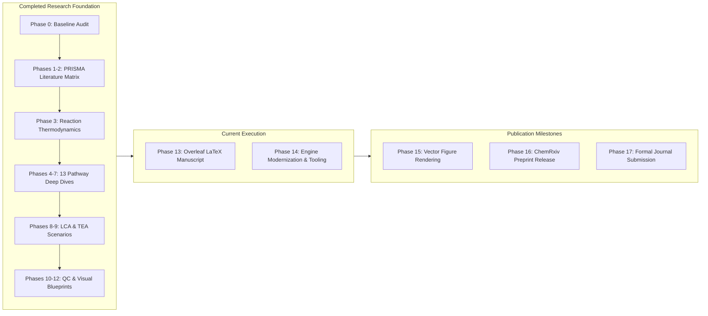

# Project Roadmap: Scientific Milestones & Publication Pipeline

> **Document:** `ROADMAP.md`  
> **Platform:** Evidence-Based CCU Research & Data Engine  
> **Status:** Canonical Research Roadmap  
> **Last Updated:** October 2026  

---

## Table of Contents

- [Executive Summary & Phased Progress](#1-executive-summary--phased-progress)
- [Completed Milestones (Phases 0–12)](#2-completed-milestones-phases-012)
- [Active & Upcoming Milestones](#3-active--upcoming-milestones)
- [Post-Publication Vision & Maintenance](#4-post-publication-vision--maintenance)

---

## 1. Executive Summary & Phased Progress

This roadmap traces the transformation of an initial 26-page unverified review draft into an authoritative, peer-reviewed journal manuscript and reproducible scientific data engine.

| Phase | Milestone Name | Scope & Deliverables | Status | Timeline |
|---|---|---|---|---|
| **Phase 0** | Baseline Audit | Forensic audit of 26-page draft; identified 10 critical review vulnerabilities | Completed | Oct 2026 |
| **Phases 1–2** | PRISMA Literature Matrix | 32-col matrix across 22 benchmarks; audited 48 baseline citations | Completed | Oct 2026 |
| **Phase 3** | Reaction Thermodynamics | 28 balanced reactions with calculated $\Delta H^\circ$, $\Delta G^\circ$, $E^\circ$ | Completed | Oct 2026 |
| **Phases 4–7** | 13 Pathway Deep Dives | 13 pathway dossiers; metric normalization (FE, EE, STY) | Completed | Oct 2026 |
| **Phases 8–9** | LCA & TEA Models | Grid carbon intensity thresholds ($CI_\text{grid}$); scenario comparison | Completed | Oct 2026 |
| **Phases 10–12**| QC & Visual Blueprints | 9 rebuilt tables; 8 vector figure blueprints; gap closure report | Completed | Oct 2026 |
| **Phase 13** | LaTeX Manuscript Drafting| Modular Overleaf LaTeX assembly adhering to target journal guidelines | Active | Oct–Nov 2026 |
| **Phase 14** | Open-Source Tooling | Production CI/CD, RFC 4180 test suite, CLI modularization | Completed | Oct 2026 |
| **Phase 15** | Vector Figure Rendering | Matplotlib/Seaborn vector rendering (600 DPI, viridis/cividis) | Planned | Nov 2026 |
| **Phase 16** | ChemRxiv Preprint | Open-access preprint deposition and Zenodo DOI minting | Planned | Nov 2026 |
| **Phase 17** | Formal Journal Submission| Final submission to *Chemical Reviews* / *Nature Catalysis* | Planned | Dec 2026 |

---

## 2. Completed Milestones (Phases 0–12)

### Phase 0: Baseline Manuscript Audit (COMPLETED)
- [x] Complete forensic audit of the 26-page baseline manuscript (`CO2_UTILIZATION_ResearchPaper_2026 (1).pdf`).
- [x] Generated `research/audit/ORIGINAL_MANUSCRIPT_ANALYSIS.md` detailing every section's claims and errors.
- [x] Formulated 21-row `research/audit/SECTION_BY_SECTION_AUDIT.csv` categorizing sections as `KEEP`, `UPDATE`, `REWRITE`, `MERGE`, or `REMOVE`.
- [x] Identified 10 fatal peer-review vulnerabilities (pro-coal claims, KS-21 solvent misattribution, magnesiothermic soot, uncredited figures).

### Phases 1–2: PRISMA Literature Search & Master Matrix (COMPLETED)
- [x] Formulated reproducible PRISMA 2020 literature protocol across OpenAlex, Crossref, and PubMed (`LITERATURE_REVIEW_PROTOCOL.md`).
- [x] Screened 1,062 unique records; curated 94 verified papers.
- [x] Built 32-column `research/literature/MASTER_LITERATURE_MATRIX.csv` tracking 22 landmark primary benchmarks.
- [x] Audited all 48 baseline citations in `research/references/REFERENCE_VERIFICATION.csv`.

### Phase 3: Chemical Reaction & Mechanism Standardization (COMPLETED)
- [x] Formulated 28 balanced candidate reactions with standard enthalpy ($\Delta H^\circ$), Gibbs energy ($\Delta G^\circ$), and standard reduction potentials ($E^\circ$) in `REACTION_DATABASE_FINAL.csv`.
- [x] Authored active-site kinetics and surface reaction mechanism guide (`REACTION_MECHANISM_ANALYSIS.md`).
- [x] Identified and profiled high-potential reaction candidates in `NEW_REACTION_CANDIDATES.md` and `NEW_REACTIONS_VERIFIED.md`.

### Phases 4–7: 13 Pathway Deep Dives & Metric Normalization (COMPLETED)
- [x] Authored 13 comprehensive pathway reports covering thermocatalytic, electrocatalytic, photocatalytic, biological, and mineralisation pathways (`research/pathways/*.md`).
- [x] Formulated `METRIC_NORMALIZATION.md`, mathematically decoupling Faradaic efficiency from single-pass conversion and carbonate crossover.
- [x] Dissected landmark papers in `research/literature/BENCHMARK_PAPER_ANALYSIS.md`.

### Phases 8–9: Life-Cycle & Techno-Economic Models (COMPLETED)
- [x] Harmonized cradle-to-grave LCA boundaries with ISO 14040/14044 (`research/lca_tea/LCA_REVIEW.md`).
- [x] Established grid carbon intensity break-even thresholds ($CI_{\text{grid}} < 120\text{ g CO}_2\text{e/kWh}$ for methanol; $<50\text{ g/kWh}$ for ethylene).
- [x] Modeled CAPEX, OPEX, electricity sensitivity, and levelized costs in `TEA_REVIEW.md` and `SCENARIO_COMPARISON.csv`.

### Phases 10–12: Visuals, Quality Control & Master Revision Blueprint (COMPLETED)
- [x] Rebuilt baseline Tables 1 and 2 into 9 comprehensive evidence-based tables (`research/tables/TABLE_AUDIT.md`, `CROSS_PATHWAY_TABLE.csv`).
- [x] Audited baseline Figures 1–5 and designed blueprints for 8 publication-grade vector figures (`FIGURE_AUDIT.md`, `FIGURE_PLANS.md`).
- [x] Audited 6 competing reviews and documented 10 industrial bottlenecks and novelty claims (`research/gaps/`).
- [x] Compiled `PUBLICATION_RISK_REGISTER.md` and `manuscript/revisions/REVISION_PLAN.md`.
- [x] Fully synchronized git repository to remote `https://github.com/L9G9N0/IP-.git`.

---

## 3. Active & Upcoming Milestones

### Phase 13: Overleaf LaTeX Full Manuscript Drafting (ACTIVE)
- [ ] Assemble modular LaTeX chapters in Overleaf matching `REVISION_PLAN.md`.
- [ ] Import 94 verified citations into `references.bib` with verified DOIs.
- [ ] Integrate chemical equations formatted via `chemformula` and `mhchem`.
- [ ] Incorporate normalized quantitative metrics into text body.
- *Target Completion:* Early November 2026.

### Phase 14: Vector Figure Rendering (PLANNED)
- [ ] Execute Matplotlib/Seaborn visualization scripts specified in `research/figures/FIGURE_PLANS.md`.
- [ ] Generate Figures 1–8 in PDF and EPS vector formats with 600 DPI raster fallbacks.
- [ ] Enforce colorblind-friendly palettes (viridis, cividis, colorbrewer).
- *Target Completion:* Mid-November 2026.

### Phase 15: Preprint Release & Open-Science Minting (PLANNED)
- [ ] Author final manuscript PDF bundle.
- [ ] Upload to ChemRxiv with CC BY 4.0 open-access license.
- [ ] Mint permanent DOI on Zenodo for the data engine repository.
- *Target Completion:* Late November 2026.

### Phase 16: Journal Peer Review & Publication (PLANNED)
- [ ] Format manuscript against target journal styleguide (*Chemical Reviews*, *Nature Catalysis*, or *Energy & Environmental Science*).
- [ ] Prepare comprehensive cover letter and reviewer suggestion list.
- [ ] Submit manuscript to editorial office.
- *Target Submission:* December 2026.

---

## 4. Post-Publication Vision & Maintenance

- **Automated Literature Scanner:** Scheduled ingestion pipelines checking OpenAlex and Crossref APIs for newly reported catalyst breakthroughs with stability runtimes $>1,000\text{ hours}$.
- **Web-Based CCU Decision Dashboard:** Interactive web tool for chemical engineers and plant operators to compute localized LCA grid abatement and levelized cost of product (LCOP).
