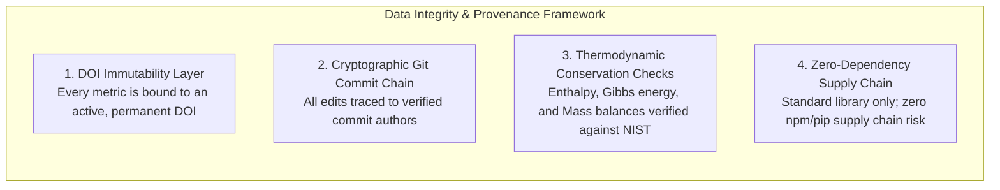

# Security Policy & Scientific Data Integrity

> **Document:** `SECURITY.md`  
> **Platform:** Evidence-Based CCU Research & Data Engine  
> **Status:** Canonical Security & Data Integrity Policy  
> **Last Updated:** October 2026  

---

## Table of Contents

- [Scope & Philosophy of Academic Security](#1-scope--philosophy-of-academic-security)
- [Supported Versions](#2-supported-versions)
- [Data Integrity & Provenance Framework](#3-data-integrity--provenance-framework)
- [Reporting a Vulnerability or Scientific Integrity Issue](#4-reporting-a-vulnerability-or-scientific-integrity-issue)
- [Vulnerability Response Timeline & SLA](#5-vulnerability-response-timeline--sla)

---

## 1. Scope & Philosophy of Academic Security

In scientific research platforms, security extends beyond traditional software vulnerability management to encompass **academic data integrity, data provenance, citation tamper-resistance, and mathematical reproducibility**.

A security breach in this domain encompasses:
- Undetected data fabrication, metric manipulation, or falsification.
- Intentional or accidental corruption of chemical reaction stoichiometry or thermodynamic state functions ($\Delta H^\circ$, $\Delta G^\circ$, $E^\circ$).
- Injection of invalid, fraudulent, or non-peer-reviewed DOIs.
- Unauthorized alteration of commit history or provenance records.
- Standard software vulnerabilities in CI/CD automation pipelines or dependencies.

---

## 2. Supported Versions

We provide active security and data integrity maintenance for the following versions:

| Version | Supported | Security & Integrity Patches |
|---|---|---|
| `1.2.x` | Yes | Active maintenance, immediate hotfixes |
| `1.1.x` | Yes | Critical scientific errata only |
| `< 1.1.0` | No | Deprecated; upgrade to latest release |

---

## 3. Data Integrity & Provenance Framework

### 3.1 DOI Immutability
All literature entries in `research/literature/MASTER_LITERATURE_MATRIX.csv` and claim evaluations in `research/evidence/CLAIM_REGISTER.csv` are anchored by persistent Digital Object Identifiers (DOIs). Unverified URLs, non-peer-reviewed blog posts, and anonymous whitepapers are strictly prohibited from serving as primary catalytic benchmarks.

### 3.2 Thermodynamic Conservation Laws
Every chemical reaction is evaluated against standard state thermochemical values from the NIST Chemistry WebBook. Any contribution violating enthalpy conservation, mass conservation, or charge neutrality will be rejected automatically by CI testing.

### 3.3 Zero Third-Party Runtime Supply Chain Risk
The platform's core generation scripts rely exclusively on the Python Standard Library (`os`, `sys`, `pathlib`, `csv`, `re`, `argparse`). By avoiding runtime third-party packages, we eliminate exposure to dependency confusion attacks, typosquatting, or compromised transitive dependencies.

---

## 4. Reporting a Vulnerability or Scientific Integrity Issue

### How to Report
If you discover a software vulnerability (e.g., in CI workflows) or a severe scientific integrity issue (e.g., data falsification or erroneous thermodynamic values in a benchmark):

**DO NOT open a public GitHub issue.**

Please report the issue confidentially via email to the project maintainers:
- **Primary Security Contact:** Anusha Rana (`anusharana510@gmail.com`)
- **Academic Lead:** Prof. Durlubh Kumar Sharma (`dsharma@iiitd.ac.in`)

### Information to Include
- Detailed description of the vulnerability or data discrepancy.
- Affected files, commit hashes, or dataset rows.
- Proof-of-concept script, reproduction steps, or conflicting peer-reviewed literature citations.
- Potential impact on published findings or automated CI processes.

---

## 5. Vulnerability Response Timeline & SLA

- **Initial Acknowledgment:** Within **24–48 hours** of report receipt.
- **Triage & Scientific Validation:** Within **5 business days**, the team will validate the issue with domain experts.
- **Remediation & Patch Release:** 
  - For critical data errata or software vulnerabilities: within **14 days**.
  - A formal erratum and security advisory will be published via GitHub Security Advisories and Zenodo release notes.
