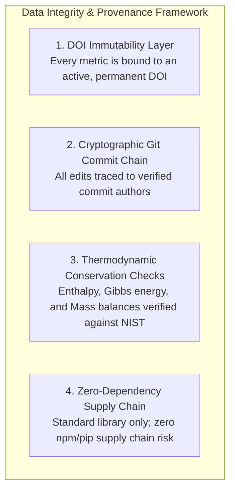

# Security & Scientific Data Integrity Policy

> **Document:** `SECURITY.md`  
> **Platform:** Evidence-Based CCU Research & Data Engine  
> **Status:** Canonical Security & Academic Integrity Policy  
> **Last Updated:** October 2026  

---

## 1. Scope & Philosophy of Academic Security

In scientific research platforms, security extends beyond traditional software vulnerability management to encompass **academic integrity, data provenance, citation tamper-resistance, and mathematical reproducibility**.

A security breach in this domain consists of:
- Undetected data fabrication or falsification
- Metric corruption or intentional misattribution
- Unverified DOI injection
- Silent degradation of thermodynamic conservation laws
- Compromise of author credentials or version history

---

## 2. Scientific Data Provenance & Immutability Architecture

To guarantee the unimpeachable integrity of our findings, this repository implements a multi-layer verification framework:

### 2.1 DOI Immutability
All literature entries in `research/literature/MASTER_LITERATURE_MATRIX.csv` and claim evaluations in `research/evidence/CLAIM_REGISTER.csv` are anchored by persistent Digital Object Identifiers (DOIs). Unverified URLs, non-peer-reviewed blog posts, and anonymous whitepapers are prohibited from serving as primary catalytic benchmarks.

### 2.2 Thermodynamic Conservation Laws
No code or data update may introduce reactions that violate physical conservation principles:
- **First Law of Thermodynamics:** Stoichiometric mass and charge conservation across all 22 reactions.
- **Second Law of Thermodynamics:** Reaction feasibility evaluated against standard Gibbs free energy ($\Delta G^\circ$). Claims that endothermic reactions proceed spontaneously without external work are rejected automatically.

### 2.3 Software Supply Chain Defense
- **Zero Third-Party Runtime Dependencies:** The data generation engine relies exclusively on Python standard library modules (`os`, `csv`, `sys`, `re`, `glob`).
- **Immunity to Dependency Hijacking:** Because there is no `package.json`, `requirements.txt` with unpinned packages, or node_modules tree, the platform is entirely immune to malicious package injection, typo-squatting, or hijacked upstream libraries.

---

## 3. Credential & Secret Management

- **Zero Secret Storage:** The repository contains zero API keys, personal access tokens, database passwords, or private keys.
- **Open REST Queries:** All bibliometric data ingestion uses open-access, public REST endpoints (OpenAlex, Crossref) that require no authentication tokens.
- **Pre-Commit Scrubbing:** Any local file containing environment variables or credentials is listed in `.gitignore` and barred from git tracking.

---

## 4. Vulnerability Disclosure & Error Reporting Protocol

We welcome corrections and vulnerability reports from the academic and open-source communities.

### Eligible Vulnerability Types
1. **Thermodynamic / Calculation Errors:** An error in stoichiometric coefficients, calculated standard enthalpy ($\Delta H^\circ$), Gibbs energy ($\Delta G^\circ$), or reduction potential ($E^\circ$).
2. **Citation / Evidence Mismatch:** A claim in `CLAIM_REGISTER.csv` or `MASTER_LITERATURE_MATRIX.csv` that contradicts the cited primary publication.
3. **Metric Conflation:** Misreported Faradaic efficiency, single-pass conversion, or current density.
4. **Git Provenance Anomaly:** Evidence of unauthorized repository tampering or history rewriting.

### Reporting Procedure
Please report any scientific or data vulnerabilities directly to the research team:

- **Lead Contact:** Anusha Rana (`anusharana510@gmail.com`)
- **Institution:** Department of Computer Science & Engineering, Indraprastha Institute of Information Technology Delhi (IIIT-Delhi)
- **Subject Line:** `[DATA INTEGRITY VULNERABILITY] <Component/Reaction ID>`

### Response Timeline
- **Initial Acknowledgment:** Within 48 hours of receipt.
- **Technical Assessment & Verification:** Within 5 business days.
- **Public Correction / Errata:** Within 10 business days via an atomic Git commit updating the relevant CSV database, `docs/CHANGELOG.md`, and `docs/DECISION_LOG.md`.
