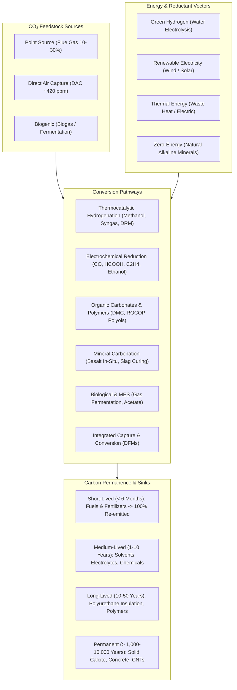
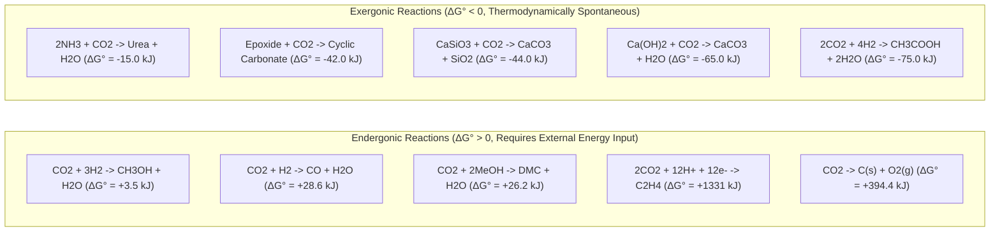
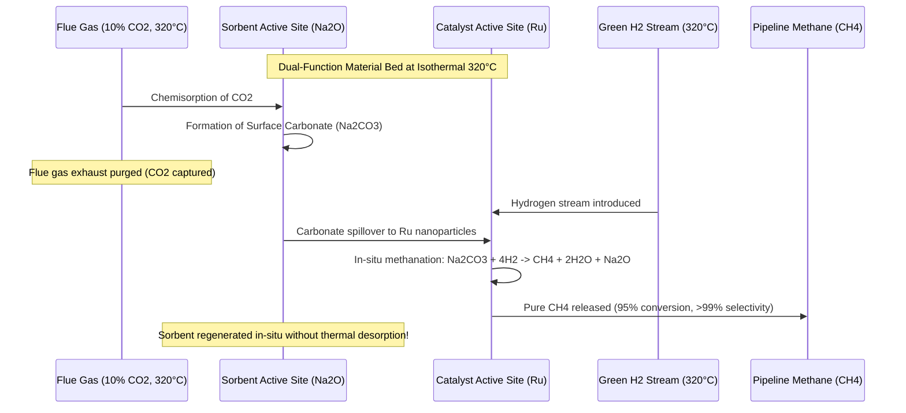

# Rebuilt Publication Figure Plans: Conceptual Specifications & Diagram Code

**Document:** `research/figures/FIGURE_PLANS.md`  
**Execution Date:** October 2026

---

## Figure 1: Comprehensive CO₂ Utilisation Architecture

---

## Figure 2: Thermodynamic Free Energy Landscape of CO₂ Activation

---

## Figure 3: Dual-Function Material (DFM) Isothermal Reactive Capture

